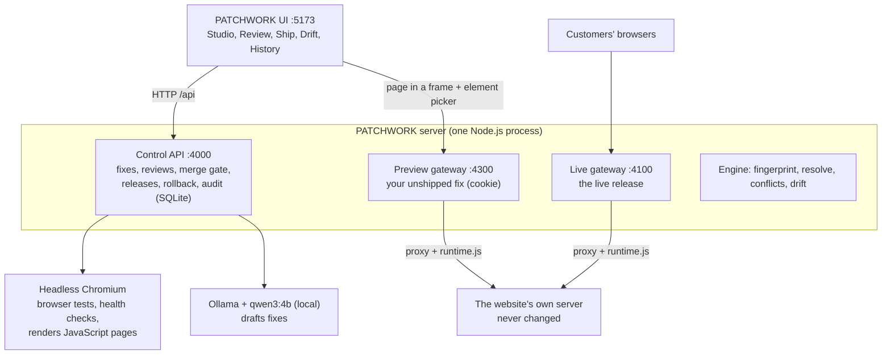
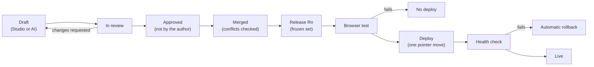

# PATCHWORK

**Fix a live website without touching its code.** PATCHWORK sits in front of a site as a gateway.
You point it at the site's address, click the broken thing (or describe the fix in plain English),
a teammate reviews it, a real browser tests it, and it goes live. Bad releases roll themselves back,
fixes survive the site's own redesigns, and every step is recorded in a tamper-evident log.

Built by team **BitBandits** for the college round.

---

## Contents

- [The problem](#the-problem)
- [What PATCHWORK does](#what-patchwork-does)
- [Quick start](#quick-start)
- [Demo walkthrough](#demo-walkthrough)
- [Connect your own site](#connect-your-own-site)
- [How it works](#how-it-works)
- [The life of a fix](#the-life-of-a-fix)
- [Under the hood](#under-the-hood)
- [Tech stack](#tech-stack)
- [Project structure](#project-structure)
- [Commands](#commands)
- [Configuration](#configuration)
- [Testing](#testing)
- [Benchmark](#benchmark)
- [Security model](#security-model)
- [Known limitations](#known-limitations)
- [Future scope](#future-scope)
- [Team](#team)

---

## The problem

A shop's checkout button is broken: a deploy introduced a typo (`startChekout()`), customers click
and nothing happens. The original developers are gone and rebuilding or redeploying the whole
application to fix one button is slow and risky.

Existing tools (tag managers, A/B testing editors) can change a page, but they target elements by a
stored CSS selector, have no review or testing step, and silently stop working when the site
changes its markup.

## What PATCHWORK does

| Feature | What it means |
| --- | --- |
| **Connect any site** | Point PATCHWORK at a site's address (a dev server, a static build, an `https://` site you own). No SDK, no code change, no rebuild. |
| **F1 Visual patching** | Click the broken element on the page and choose a fix in plain words. Nine kinds of change; fixes are data, never scripts. |
| **Ask PATCHWORK (local AI)** | Describe the fix in English ("make the checkout button take people to the checkout page"). A local model drafts it, a real browser tests it, one automatic revision if needed. The AI never submits, merges or deploys. |
| **F2 Element tracking** | Every fix remembers its element by 13 weighted clues, so it survives renamed classes and moved elements, and refuses to guess when unsure. |
| **F3 Review and conflict detection** | Every fix is approved by a teammate (never its author). Two fixes that change the same thing on the same element are blocked until a reviewer decides. |
| **F4 Isolated preview** | See your unshipped fix on the real site; customers keep seeing the live version. |
| **F5 Automated verification** | Before release, headless Chromium runs every fix's checks, compares page errors and screenshots against the live site. |
| **F6 Deploy and rollback** | Releases go live in one step; a failed health check rolls back automatically; any earlier healthy version is one click away. |
| **F7 Audit trail** | Every action, by whom and when, in a SHA-256 hash chain that shows if history was altered. |
| **Drift Sentinel** | When the site redesigns itself, every live fix is re-checked; PATCHWORK re-finds what it can prove, refuses the rest and builds a safe release. |

## Quick start

**Prerequisites:** macOS or Linux, Node.js 24, Git. Optional: [Ollama](https://ollama.com) for
Ask PATCHWORK (`brew install ollama`); without it, the manual fix flow still works.

```bash
git clone https://github.com/Adnan-Khan15/BitBandits_college_round patchwork
cd patchwork
npm ci
npx playwright install chromium
./patchwork install      # once: adds the `patchwork` command to your PATH
patchwork                # start everything
```

`patchwork` starts Ollama (downloading the `qwen3:4b` model on first run), resets the demo data,
builds, starts every service, seeds the demo and opens the UI at **http://localhost:5173**. It takes
about 25 seconds.

| Command | What it does |
| --- | --- |
| `patchwork` | Fresh start of everything, Ollama included |
| `patchwork --keep` | Start again without resetting the data |
| `patchwork stop` | Stop everything, Ollama included (from any terminal; Ctrl+C also works) |
| `patchwork help` | Usage |

| Address | What it is |
| --- | --- |
| http://localhost:5173 | The PATCHWORK UI (use this one: element picking only works here) |
| http://localhost:4200 | ShopLite's own server, the untouched original (broken checkout) |
| http://localhost:4100 | The live site through PATCHWORK: what customers see |
| http://localhost:4300 | The preview gateway (opened by the Studio) |
| http://localhost:5500 | Chai & Code Café, a second sample site to connect |
| http://localhost:4000 | The control API (also serves the built UI) |

Logs are written to `data/logs/`.

## Demo walkthrough

The team bar in the header switches who you act as: **Gaurav** and **Adnan** (developers),
**Vishwaa** (reviewer), **Kshant** (release manager). Buttons that need another role say who does
it, e.g. "Approve as Vishwaa".

1. **The problem.** Open http://localhost:4200/cart and click *Proceed to checkout*: nothing
   happens, and the console shows `startChekout is not defined`.
2. **Sites.** ShopLite is connected by its address. *Connect the sample site* adds Chai & Code
   Café in one click.
3. **Studio.** In *Ask PATCHWORK*, type "make the checkout button take people to the checkout page"
   and click *Draft it*: the local model drafts the fix, a real browser tests it, and the Preview
   shows it working while the Live tab is still broken. *Where is this change?* tells you it is not
   live yet. Click *Send for review*. (Or do it by hand: *Pick something on the page*, choose
   *Make it do something when clicked*, enter `/checkout`.)
4. **Review.** *Approve as Vishwaa*, *Merge as Vishwaa*. Then open Adnan's "Send checkout to the
   cart summary": the merge is blocked by a conflict card explaining that both fixes change what
   the same button does.
5. **Ship.** *Create release*, *Run browser test* (checks, page errors, before/after screenshots),
   *Deploy as Kshant*. A Studio window left on the Live tab updates by itself. The shop's code is
   unchanged: `git status fixtures/target-site` shows nothing.
6. **A bad release.** Merge "Restyle checkout button" (it sets `pointer-events: none`), create a
   release and *Force deploy* it with a reason. The health check fails and PATCHWORK rolls back to
   the previous release automatically.
7. **Drift Sentinel.** Once the rollback's health check has passed, click *Run drift drill*:
   ShopLite switches to its v2 redesign, every live fix is re-checked, and a safe release is built
   and tested. Toggle *What would a selector-only tool do?* to see every fix silently lost. Ship the
   safe release, then *Restore original site (v1)*.
8. **History.** Every step as a sentence, with the chain check ("chain intact").

More to try: on ShopLite's home page ask "reduce prices of all goods by 10%"; on the café ask "make
the Book a table button take people to the booking page".

## Connect your own site

1. Run the site somewhere PATCHWORK can reach it: a dev server (`npm run dev`, e.g.
   `http://localhost:3000`), a static build served locally, or a public `https://` address you own.
2. Open **Sites → Connect a site**: a name, the address (no path) and the pages to track
   (`/ /pricing`). Connecting needs the release manager (the button acts as Kshant).
3. Click **Switch to this site**. The live gateway (`localhost:4100`) and the preview gateway
   (`localhost:4300`) now serve your site, and the Studio, Review, Ship, Drift Sentinel and History
   work on it.

Fixes reach `localhost:4100` only after Review and Ship; your own server never changes. Pages built
by JavaScript (React, Vue, Vite, Next) are rendered in headless Chromium for analysis. Sites that
forbid embedding still work: the gateway adapts their framing headers and Content-Security-Policy.
Only connect sites you own or run.

## How it works

PATCHWORK never edits the website. Visitors open the site through PATCHWORK's gateway, which fetches
each page from the site's own server and adds one script, `runtime.js`, that applies the approved
fixes in the visitor's browser.



- **Control API (:4000)** stores fixes, reviews, releases and the audit log, and runs the merge gate,
  browser tests and Drift Sentinel.
- **Live gateway (:4100)** serves the live release; **preview gateway (:4300)** serves one person's
  unshipped fix, chosen by a cookie, so the two never mix.
- **The engine** is one TypeScript library used on the server (conflicts, drift) and inside
  `runtime.js` in the page (finding elements and applying fixes).
- **Headless Chromium** (Playwright) tests fixes like a real visitor and renders JavaScript-built pages.
- **Ollama** runs `qwen3:4b` on the machine; it only drafts fixes.

## The life of a fix



1. **Draft:** the fix stores the element's fingerprint, its operations and the checks a browser
   should run. Every save is a numbered revision.
2. **In review:** a teammate approves or asks for changes. Authors cannot approve their own fix.
3. **Merged:** the merge gate re-finds every element on the current page and blocks conflicting
   fixes until the reviewer picks a side ("keep this fix" orders the new fix after the old one).
4. **Release:** a frozen, numbered set of merged fixes with a hash of its contents.
5. **Browser test:** only a passing release can deploy (unless force-deployed with a reason).
6. **Deploy:** one database transaction moves the site's live-release pointer.
7. **Health check:** a browser run on the live site; on failure the pointer moves back by itself.
8. **Live:** customers see the fix. Every step is one event in the audit chain.

## Under the hood

### Element tracking

A fingerprint stores 13 clues with weights: tag, id, test id, form name, visible text, neighbouring
text (1.5 each), accessible name (1.0), classes, link target, document path, ancestors, screen
position (0.5 each) and sibling position (0.25). Every element on a page is scored against it. The
best match is used only if it scores at least **0.9** (exact) or **0.65** (relocated) and beats the
runner-up by **0.15**; otherwise the fix is skipped and reported as ambiguous or not found, never
applied to a guess.

### The browser runtime

`runtime.js` (about 20 KB, bundled with esbuild) loads the manifest for the page (the live release or
a preview), resolves all of a fix's elements before applying anything (all or nothing), marks what
it touched so nothing is applied twice, re-applies when the page changes itself (up to 20 times),
hides the page for at most 0.8 s to avoid flicker, and reports applied, skipped and error events.

### Gateways

Both gateways proxy the connected site and inject the runtime into HTML only. The preview gateway
serves the preview named in the `pw_preview` cookie; the live gateway never reads it. For real sites
the gateway removes framing restrictions, adds `'self'` to a strict CSP (or removes a
`'strict-dynamic'` policy that would block the script), and rewrites links to the site's own address
so clicks stay on the patched version. It only contacts the connected site's address.

### Ask PATCHWORK

1. The server builds the page as customers see it (live fixes applied) and lists up to 150 elements
   with their text and context ("₹2,499, in Wireless Headphones").
2. `qwen3:4b` answers in a fixed JSON schema: one change per element, quoting each element's
   current text.
3. The server checks every quote against the real page (re-targeting or rejecting mismatches), does
   percentage arithmetic itself (₹2,499 × 0.9 = ₹2,249), refuses links to pages that return 404, and
   runs the same validation as a human fix. A rejected answer gets one retry with the exact reason.
4. A real browser tests the draft; if its own checks fail, the model revises once. Then a person
   decides. Price changes carry a note: the page shows new prices, the shop still charges its own.

### Conflict detection

**Blocking:** two fixes set the same property of the same element to different values; one fix
replaces the text of an element another edits inside; both move the same element; the new fix's
element is ambiguous or not found. **Warnings:** one fix hides what another edits; both insert at
the same spot; the element changed since the fix was made.

### Verification

Two clean Chromium contexts at 1280×800: the live site (baseline) and the candidate release or
preview. PATCHWORK records which fixes applied, runs each fix's checks (click, fill, expect text,
expect visible or hidden, expect URL; 5 s each), keeps only page errors that are new compared with
the baseline, and compares full-page screenshots with the fixed elements masked out. A check of an
older fix that a newer fix deliberately overrides is reported as superseded. A run fails on a failed
check, a fix that did not apply, or a new page error; screenshot differences are reported only.

### Drift Sentinel

A new snapshot of each tracked page is compared with the last one; when it changed, every live fix is
re-resolved and labelled healthy, healed, at risk or broken. "Build a safe release" keeps the fixes
that can be proven and leaves out the rest, across every checked page. The selector-only comparison
re-runs the same check using only the stored CSS selector.

### Audit chain

`hash = sha256(previousHash + "\n" + canonicalJSON(event))`, starting from 64 zeros. Events are only
ever inserted. Verifying recomputes every hash; the first mismatch is reported as "broken at #n".

## Tech stack

| Layer | Tool |
| --- | --- |
| Language | TypeScript 5.9 (strict), Node.js 24, ES modules |
| Monorepo | npm workspaces |
| Server | Fastify 5 (three listeners in one process) |
| Database | SQLite via Node's built-in `node:sqlite` |
| Validation | Zod schemas, semantic validator, DOMPurify for inserted HTML |
| Server-side page model | jsdom |
| Browser runtime | esbuild bundle (`runtime.js`) |
| Browser automation | Playwright with headless Chromium |
| Visual diff | Screenshots compared in Chromium using pixelmatch's YIQ colour distance |
| Local AI | Ollama running `qwen3:4b` with JSON-schema structured output |
| UI | React 19, Vite 8, CSS modules |
| Tests | Vitest; Playwright scripts for end-to-end runs |
| Hashing | `node:crypto` SHA-256 |

Everything is open source and runs locally: **₹0** to run.

## Project structure

```
patchwork/
├── patchwork                    start / stop command
├── packages/
│   ├── shared/                  contracts: types, Zod schemas, errors, limits
│   ├── engine/                  fingerprints, resolver, operations, conflicts, drift; bench/
│   └── runtime/                 runtime.js: applies fixes in the page, picker, events
├── apps/
│   ├── server/src/
│   │   ├── gateway/             live + preview gateways (proxy, injection, CSP, cookie)
│   │   ├── core/                fixes, reviews, merge gate, previews, sites, AI routes, audit
│   │   ├── assist/              Ask PATCHWORK: model call, candidates, grounding
│   │   ├── releases/            releases, deploy, health check, rollback
│   │   ├── verify/              browser tests, page errors, screenshot diff
│   │   ├── snapshots/           page snapshots, JavaScript rendering
│   │   ├── drift/               Drift Sentinel, benchmark endpoint
│   │   └── db/                  SQLite schema, migrations, seed data
│   └── web/src/                 UI: Sites, Studio, Review, Ship, Drift Sentinel, History
├── fixtures/
│   ├── target-site/             ShopLite v1 and v2 (the demo shop and its redesign)
│   ├── sample-site/             Chai & Code Café (a second site to connect)
│   └── drift-benchmark/         15 tuning + 15 held-out before/after page pairs
├── scripts/                     reset, seed, demo-setup, smoke-slice
└── docs/PLAN.md                 full design: requirements, architecture, contracts
```

## Commands

| Command | What it does |
| --- | --- |
| `patchwork` / `patchwork stop` | Start / stop the whole demo, Ollama included |
| `npm run reset` | Fresh database in `data/` with the seeded team and ShopLite |
| `npm run build` | Runtime bundle, web app and typecheck |
| `npm run dev` | Development mode: ShopLite, runtime watch, server and UI together |
| `npm start` | Build, then run the server (control :4000, live :4100, preview :4300) |
| `npm run target` | ShopLite on :4200 |
| `npm run sample` | Chai & Code Café on :5500 |
| `npm run dev:web` | UI on :5173 |
| `npm run demo:setup` | Seed the demo through the real API (needs running servers) |
| `npm run bench -- --set all` | Element-tracking benchmark on tuning and held-out cases |
| `npm run typecheck` | Type checks for every workspace |
| `npm test` | Unit tests |
| `npm run smoke:slice` | End-to-end HTTP check on a fresh `npm run reset` with servers running |

## Configuration

Copy `.env.example` to `.env` (the `patchwork` command does this for you). The defaults work as-is.

| Variable | Default | Meaning |
| --- | --- | --- |
| `PW_CONTROL_PORT` / `PW_LIVE_PORT` / `PW_PREVIEW_PORT` | 4000 / 4100 / 4300 | Server ports |
| `PW_TARGET_PORT` | 4200 | ShopLite's port |
| `PW_PROJECT_ID` | `prj_shoplite` | Site served when none is selected |
| `PW_ALLOWED_UPSTREAMS` | `http://localhost:4200` | Upstreams allowed besides connected sites |
| `PW_EDITOR_ORIGIN` | `http://localhost:5173` | The only origin the element picker accepts |
| `PW_PREVIEW_ORIGIN` | `http://localhost:4300` | Preview gateway address |
| `PW_DB_PATH` / `PW_ARTIFACTS_DIR` | `./data/patchwork.db` / `./data/artifacts` | Database and screenshots |
| `PW_ASSIST_PROVIDER` | `none` (set to `ollama` by `patchwork`) | Turns Ask PATCHWORK on |
| `PW_ASSIST_MODEL` / `PW_OLLAMA_URL` | `qwen3:4b` / `http://localhost:11434` | Local model |

## Testing

```bash
npm run typecheck && npm test        # types + 105 unit tests
npm run reset                        # then, with `npm run target` and the server running:
npm run smoke:slice                  # preview isolation, review, conflict, verified deploy, rollback, audit
```

## Benchmark

`npm run bench -- --set all` re-anchors elements across 30 before/after page pairs (renamed ids and
classes, moved and wrapped elements, edited text, changed tags, removed elements, look-alike decoys).
The 15 held-out cases were written separately and are never used for tuning.

| Method | Held-out: re-found | Held-out: wrong element | Held-out: correctly refused |
| --- | --- | --- | --- |
| **PATCHWORK** | 61.5% | **0%** | 100% |
| Stored CSS selector | 46.2% | 0% | 100% |
| Absolute XPath | 53.8% | 13.3% | 100% |
| Best match, no threshold | 92.3% | 20% | 0% |

On the 15 tuning cases PATCHWORK re-finds 100% with 0% wrong. Wrong-element rate is the key safety
number: a fix applied to the wrong element is worse than no fix.

## Security model

- Fixes are declarative: 9 operation kinds, an allowlist of attributes and style properties, no
  scripts, no event-handler attributes, no `javascript:` links; inserted HTML is sanitised with
  DOMPurify. AI drafts pass the same validation.
- Previews are isolated by a cookie on a separate port; the live gateway never reads it.
- The gateway only contacts the connected site's address; request paths cannot change the host.
- All SQL is parameterised; screenshot downloads reject path traversal.
- The audit log is append-only and hash-chained.
- Identity is a team picker for the demo, not authentication, and every server listens on
  `127.0.0.1` only (see limitations).

## Known limitations

- **No real login.** The team bar is a picker; production needs sign-in and a host-header check.
- **One active site at a time.** The gateways serve the site selected on the Sites screen.
- **Fixes apply in the browser.** Visitors need JavaScript; the page is hidden for at most 0.8 s.
- **Display, not business logic.** A price fix changes what the page shows, not what the shop charges.
- **Drift on the v2 redesign:** the checkout fix is refused (best match 0.41, below 0.65) because the
  button's id, classes, neighbours and position all changed at once; the price fix is re-found.
- **Health check** is one browser run after deploy; there is no real-user error window yet.
- **Screenshot differences warn but never block.**
- **Small benchmark:** 15 tuning and 15 held-out cases.

## Future scope

1. Real accounts: sign-in, per-site roles, host checks, signed audit exports.
2. Many sites at once, routed by domain; a hosted gateway or CDN worker in front of production traffic.
3. Server-side apply of simple fixes (text, attributes, hide) so no JavaScript or flicker is needed.
4. Browser snapshots with element positions, and a model as a second opinion on ambiguous matches.
5. Real-user health: count errors and skipped fixes after each deploy and roll back on spikes.
6. One-click healing: when Drift Sentinel re-finds an element, propose the updated fix in Review.
7. Alerts and handover: notifications on drift and rollbacks, issues for the original developers.
8. A larger benchmark built from real open-source sites.

## Team

| Member | Area |
| --- | --- |
| Vishwaa | Platform and integration: contracts, validation, previews, merge and conflict workflow, audit |
| Adnan | Patch engine and drift: fingerprints, resolver, operations, runtime, Drift Sentinel, Ask PATCHWORK |
| Kshant | Delivery and verification: gateway, snapshots, browser tests, releases, rollback |
| Gaurav | UI and demo sites: Studio and screens, ShopLite, Chai & Code Café |
